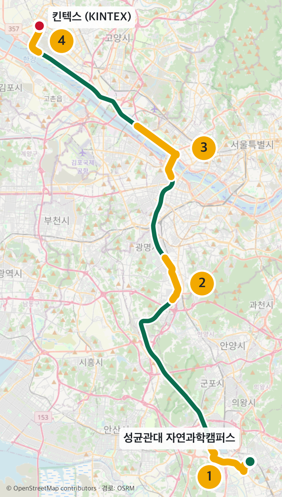
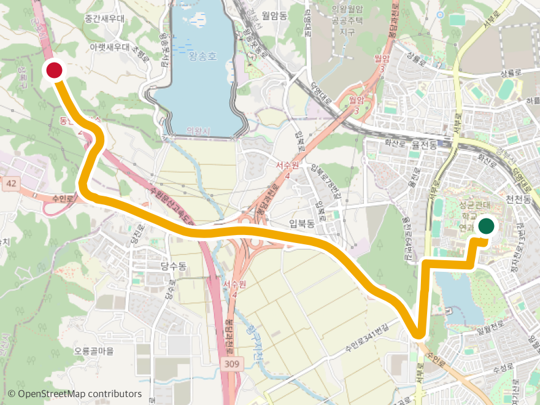
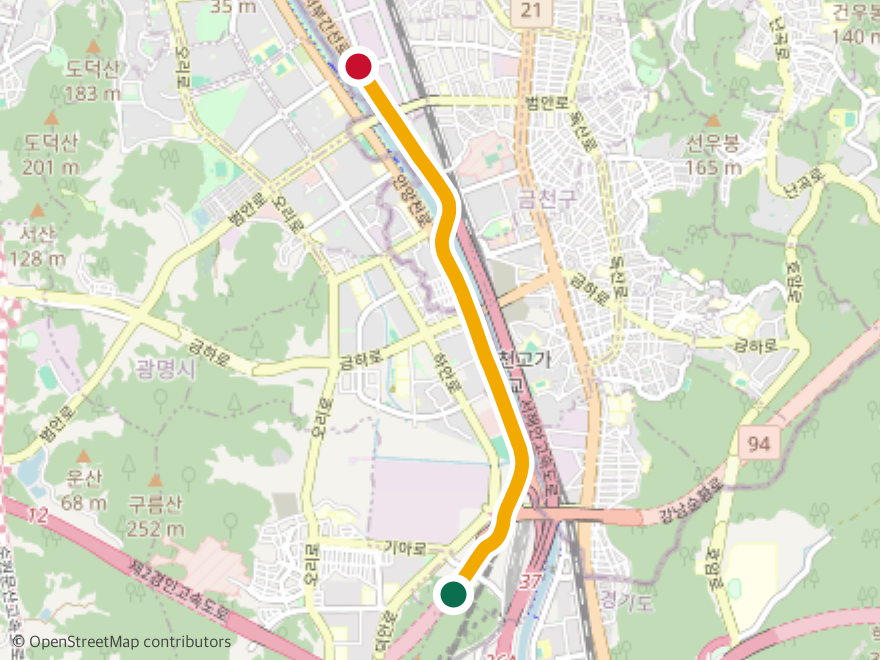
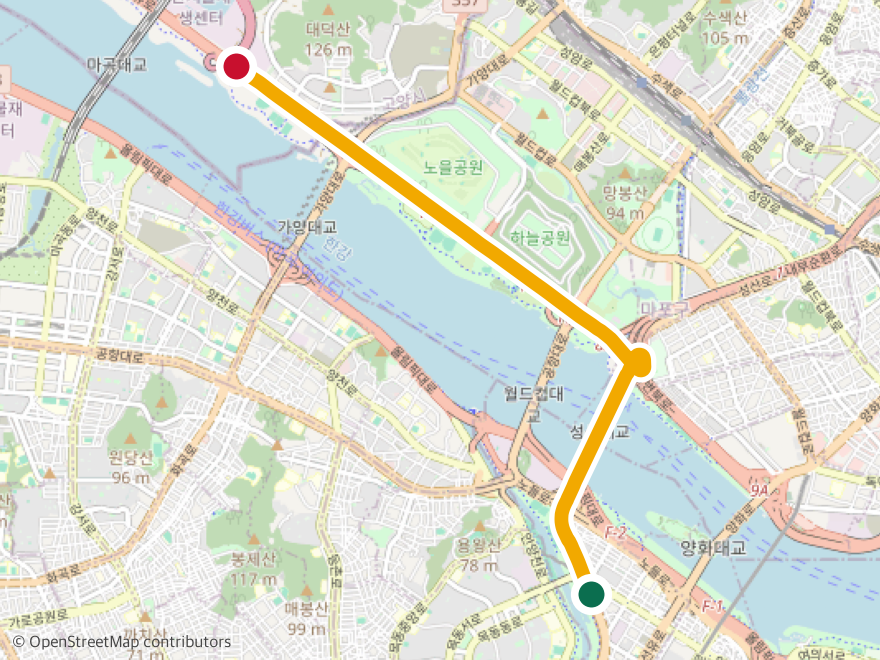
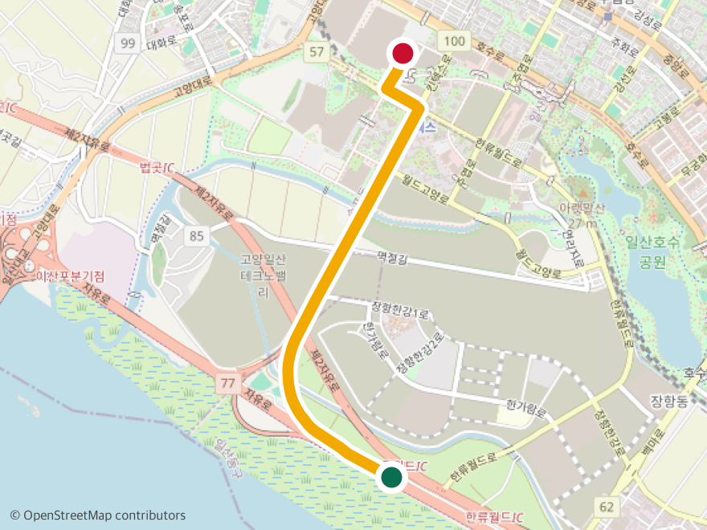
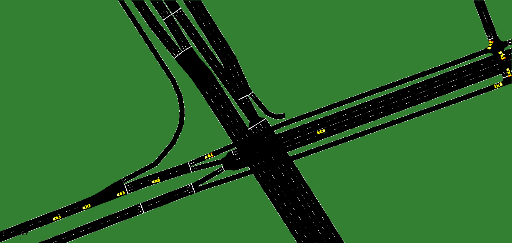

# 성균관대 → 킨텍스: 로봇박람회 가는 길을 자율주행차가 달린다

> 자율주행 인공지능 및 제어 · 팀 프로젝트 · 팀 이름 미정
>
> 성균관대 자연과학캠퍼스에서 일산 킨텍스까지 **실제로 가는 59.4 km 경로**를 SUMO로 구현하고,
> 그 위에서 일반 차량과 함께 달리는 자율주행차(AV)를 학습시킨다.



## 왜 이 길인가

1. **수업에서 실제로 가는 길.** 킨텍스 로봇박람회 견학 경로라, 발표와 견학 보고서가 하나의 이야기로 이어진다.
2. **수도권 도로 유형이 한 줄로 이어진다.** 캠퍼스 앞 도심 교차로 → 고속도로 → 지하 고속화도로 → 한강 횡단 → 자유로.
3. **결정 없이는 도착할 수 없다.** 합류·분기가 23곳이라 출구를 놓치면 목적지에 못 간다.
   AV가 "언제 어느 차선으로 옮길지"를 판단해야 하는 도로다.

| 전체 경로 | 합류·분기·회전 | 학습·평가 구간 |
|:-:|:-:|:-:|
| **59.4 km** | **23곳** | **4개** |

<br clear="right">

## 4개 구간

60 km를 통째로 학습하면 한 에피소드가 1시간이 넘고, 23곳을 모두 무사히 지나야 해서
충돌률 5% 미만을 맞추기 어렵다. 그래서 **성격이 다른 대표 구간 4곳**에서 학습·평가하고,
전체 경로는 마지막에 이어 달리는 시연 영상으로 보여준다.

| | 구간 | 길이 | 경로 | 핵심 구조 |
|:-:|---|:-:|---|---|
|  | **1 출발** | 6.2 km | 캠퍼스 → 수인로 → 수원문산고속도로 | 신호 교차로, 진입 램프 합류 |
|  | **2 분기** | 4.8 km | 수원문산고속도로 → 서부간선도로 → 지하도로 | 고속도로 간 연결, 지상·지하 갈림길 |
|  | **3 한강** | 7.5 km | 서부간선로 → 성산대교 → 강변북로 → 자유로 | 한강 횡단, 합류·진출 엇갈림 |
|  | **4 도착** | 3.6 km | 자유로 → 진출 램프 → 킨텍스로 | 출구 차선 확보, 도심 신호, 목적지 |

## 도로를 만드는 방법

```
OpenStreetMap 원본 → 영역 자르기·좌표 보정 → netconvert로 SUMO 변환 → 로드뷰로 차선·신호 보정 → 검증
```

교수님 5장 문서의 **방법 B(외부 도로 파일 + netedit 편집)**에 해당한다.
실제 지도 데이터로 정확한 뼈대를 세우고, 지도에 빠진 차선 수와 신호를 로드뷰로 직접 보정한다.
자세한 내용과 근거: [docs/02_road_pipeline.md](docs/02_road_pipeline.md)

## 지금까지 확인한 것

**구간별 지도 정보 보유율** (경로 위 도로 중 OpenStreetMap에 차선 수가 들어 있는 비율)

| 구간 | 차선 수 있음 | 경로 근처 신호 | 보정 부담 |
|---|:-:|:-:|---|
| 1 출발 (학교 앞) | 10% | 3개 | 가장 큼 |
| 2 분기 | 82% | 1개 | 작음 |
| 3 한강 | 64% | 0개 | 중간 |
| 4 도착 (일산) | 69% | 6개 | 중간 |

**구간 2 SUMO 변환 시험** ([segments/seg2_branch](segments/seg2_branch))

| 항목 | 결과 |
|---|---|
| 도로망 | 1.95 km × 4.87 km, 도로 88 km, 교차로 259개, 신호 11개 |
| 경로 연결 | 4.92 km 끊김 없이 연결 (실제 4.8 km, 오차 10 m 이내) |
| 차량 시험 | 25분간 1,050대 투입, 경로 차량 150대 전부 완주 |
| 발견한 문제 | 금하로 교차로에서 4대가 2분 넘게 대기 → 신호 누락 의심 |

 

## 일정

| 날짜 | 할 일 |
|---|---|
| **11/10 (화) 13:00** | 중간발표 (3분): 지역, 구조, 상호작용, 데이터 컬럼, 역할 |
| 11/10 ~ 11/17 | 4개 구간 변환·보정, 일반 차량 구성, 환경 코드를 새 도로에 연결 |
| **11/17 또는 11/24 (화)** | 컨설팅 (팀당 5분) |
| 11/17 ~ 11/24 | 구간별 학습, 100회 평가, 데이터 수집 시작 |
| **11/28 (토)** | 최종발표 (13분) + 코드·데이터·프로젝트 페이지 제출 |

## 역할 (제안)

| 역할 | 주요 작업 |
|---|---|
| 도로 A | 구간 1·2 변환, 로드뷰 보정, 신호 추가 |
| 도로 B | 구간 3·4 변환, 램프·분기 연결 확인 |
| 교통·데이터 | 일반 차량 4종 혼합·교통량, 데이터 수집, Hugging Face |
| AV 학습 | 환경 코드 연결, 관측·보상 설계, 학습·평가, 프로젝트 페이지 |

오늘 회의에서 정할 것: [docs/01_meeting_agenda.md](docs/01_meeting_agenda.md)

## 저장소 구조

```
├── README.md                  ← 지금 이 문서
├── docs/
│   ├── 01_meeting_agenda.md   첫 회의 안건
│   ├── 02_road_pipeline.md    지도 → SUMO 변환 방법과 근거
│   ├── 03_data_columns.md     수집 데이터 컬럼 (교수님 기본 + 추가 제안)
│   └── images/                지도, SUMO 화면
├── tools/
│   ├── crop_osm.py            OSM 영역 자르기·좌표 보정
│   └── make_maps.py           경로·구간 지도 그리기
├── segments/
│   └── seg2_branch/           구간 2 도로망 + build.sh (재현 스크립트)
├── data/route/                경로 원본 (OSRM)
└── presentation/              중간발표 초안
```

교수님 기본 코드(`env/`, `train.py` 등)는 구간 도로가 정해진 뒤 이 저장소로 가져와 수정한다.

---

지도 데이터 © [OpenStreetMap](https://www.openstreetmap.org/copyright) contributors (ODbL) ·
경로 계산 [OSRM](https://project-osrm.org/)
