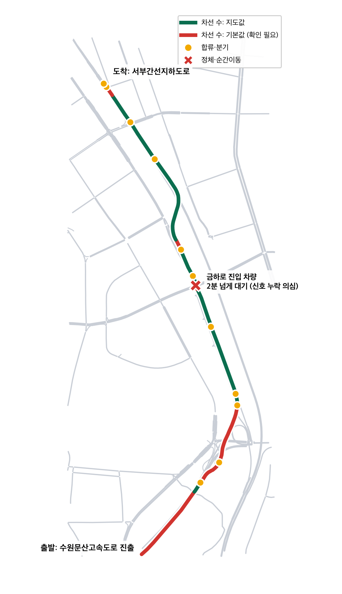

# 구간 2: 분기 (수원문산고속도로 → 서부간선도로 → 서부간선지하도로)

경로상 23.8 ~ 28.6 km. 고속도로에서 빠져나와 서부간선도로에 합류한 뒤, 지상·지하도로가 갈리는 지점까지.

## 다시 만들기

```bash
bash build.sh
sumo-gui -n seg2.net.xml -r bg.rou.xml,route.rou.xml --step-length 0.5
```

| 파일 | 내용 | 저장소 포함 |
|---|---|---|
| `build.sh` | 원본 받기 → 자르기 → 변환 → 일반 차량 생성 | O |
| `seg2.osm.xml` | OpenStreetMap 원본 (2026-10-27 받음, 지도가 바뀌어도 같은 결과를 내기 위해 보관) | O |
| `seg2.net.xml` | SUMO 도로망 (보정 전) | O |
| `route.rou.xml` | 우리 경로를 따라가는 차량 (6초에 1대) | O |
| `bg.rou.xml` | 시험용 무작위 일반 차량 (`build.sh`가 생성) | X |

## 시험 결과 (보정 전)

| 항목 | 결과 |
|---|---|
| 도로망 | 1.95 km × 4.87 km, 도로 88 km, 교차로 259개, 신호 11개 |
| 경로 | 4.92 km, 도로 22개, 실제 경로와 10 m 이내 |
| 경로 위 구조 | 분기 6곳, 합류 5곳 |
| 25분 주행 | 1,050대 투입, 경로 차량 150대 전부 완주 (평균 272초, 대기 5초) |
| 순간이동 | 4건, 모두 금하로 → 큰길 진입 교차로 (신호 없음으로 변환됨) |

## 보정할 곳

1. **차선 수가 지도에 없는 도로:** 경로 4.92 km 중 1.8 km (도로 7개, 주로 고속도로 진출 램프)
2. **값이 의심스러운 도로:** 서부간선도로 일부가 1차선으로 적혀 있음
3. **신호 누락 의심:** 금하로 교차로


